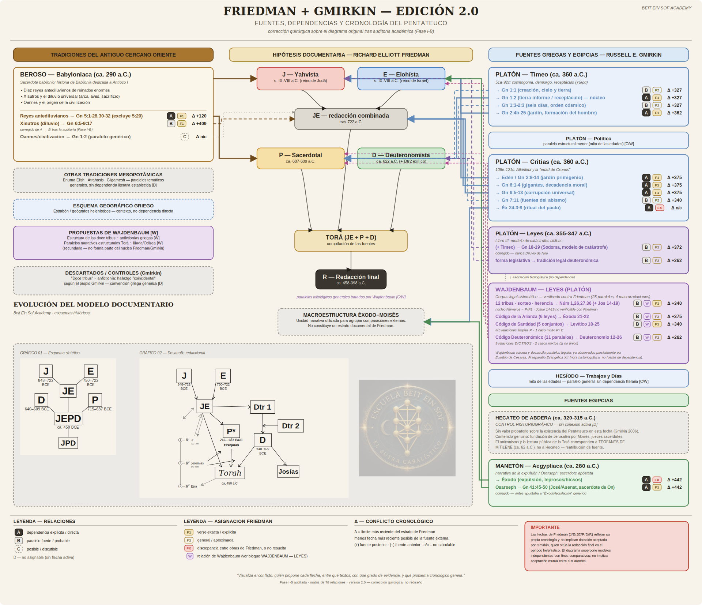

# BESA | Friedman + Gmirkin

Public presentation of **Friedman + Gmirkin - Edition 2.0**, a Spanish-language diagram on sources, dependencies and chronology of the Pentateuch, presented by Beit Ein Sof Academy / BESA.

The diagram compares independent historical models. Its juxtaposition does not imply agreement between the authors, their endorsement of this presentation, or an established scholarly consensus. Read the qualifications and legends within the diagram alongside its arrows and dates.

## What this repository contains

- One raster presentation image, 1920 x 1654 pixels.
- This introduction and a rights notice.
- Ignore rules to help keep editable and production files out of this edition.

## What remains outside this public edition

The SVG master, vector PDF, source generator, original ZIP, original Git history, 4K image and print-resolution exports are not included. This is a separate presentation repository, not a copy of the working repository.

The public PNG can be viewed, saved and copied. Excluding the originals prevents this repository from supplying the original editable vector files; it does not prevent screenshots, tracing or reconstruction of the diagram. Ignore rules are a precaution, not access control. Review staged files before every publication.

See [RIGHTS.md](RIGHTS.md) for the publication notice. Visit [Beit Ein Sof Academy](https://beiteinsofacademy.com/) for the academy's website.
